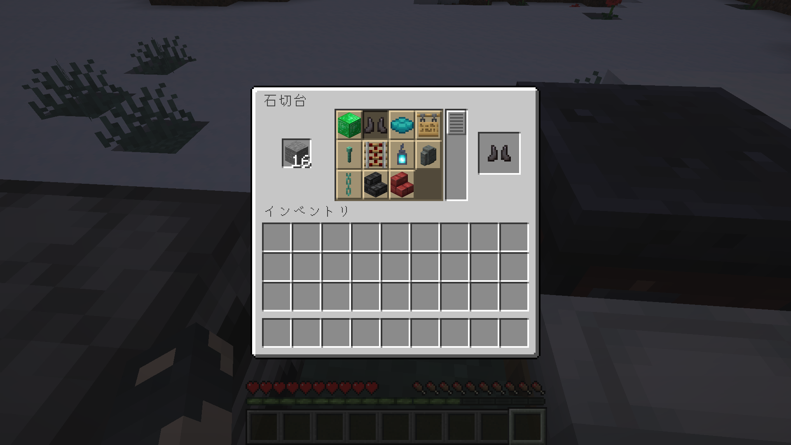

# daily-recipe-shuffle



[](https://github.com/karashilys/daily-recipe-shuffle/actions/workflows/ci.yml)
[](https://github.com/karashilys/daily-recipe-shuffle/releases/latest)


[](LICENSE)

毎朝クラフトレシピがシャッフルされる鬼畜プラグイン  
今日のレシピ詰んでる？明日を待て。

## 導入

1. [papermc.io](https://papermc.io/downloads/paper) から Paper 26.3 のサーバーをダウンロード
2. [Releases](https://github.com/karashilys/daily-recipe-shuffle/releases) から最新の `daily-recipe-shuffle-<版>.jar` をダウンロード
3. サーバーの `plugins/` フォルダに置き、サーバーを起動

設定ファイルやコマンドはありません。入れるだけで動きます。

## 遊び方

- マイクラ内で朝になる(日が変わる)と、レシピの完成品が入れ替わります
- その日に何ができるかは、作業台の完成品スロットやレシピブックで確かめてください
- 作れなくなった物があっても、翌日には別の並べ方で作れるようになります(それがサバイバルで現実的かはおいておいて)。

## 入れ替わるもの

入れ替えは、完成品と個数の組を単位にして、種類をまたいで行います。かまどで焼いた結果が、作業台のレシピに移ることもあります。

- **入れ替わる**: 作業台でのクラフト、かまど・溶鉱炉・燻製器・焚き火、石切台、鍛冶台のネザライト強化
- **入れ替わらない**: 作業台そのもののレシピ、染色・花火・旗・地図などの特殊レシピ、鍛冶型の装飾、醸造、村人との取引

データパックや他のプラグインが追加したレシピも、同じ規則で入れ替わります。

### 細かい決まり

- **作業台に材料を並べたまま日が変わった場合**: 材料を置き直すまでは前の日の完成品が表示され、そのとおりにクラフトされます。
- 同じワールドで同じ日なら、入れ替えは常に同じです(入れているデータパックやプラグインが同じ場合)。
- ベッドで寝たり、コマンドで時を飛ばして日付が変わるとレシピが変わります

## 開発

`serverTest` と `runServer` は `run/` でPaperを起動します。初回はMinecraftのEULA([https://aka.ms/MinecraftEULA](https://aka.ms/MinecraftEULA))への同意が必要です。`run/eula.txt` の `eula=false` を `eula=true` に書き換えてください。

### ビルド

```
./gradlew build
```

`build/libs/daily-recipe-shuffle-<版>.jar` ができます。

### テスト

| コマンド | 内容 |
|---|---|
| `./gradlew test` | 単体テスト(JUnit)。入れ替えの性質(決定的、全単射、元と同じ完成品にならない、列挙順に依存しない)、分類、日付の計算 |
| `./gradlew serverTest` | 実サーバー検証。開発用サーバーを起動し、全レシピの分類、登録内容、作業台での実際のクラフト結果などを確かめてから停止する。失敗するとビルドも失敗する |

### 開発用サーバー

```
./gradlew runServer
```

`run/` でプラグイン入りのPaperサーバーが起動します。

## ライセンス

[MIT License](LICENSE)
